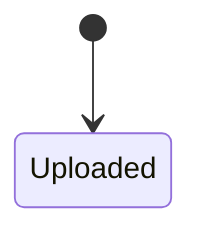

# <Feature>: stories and acceptance criteria

- **ADR:** docs/adr/NNNN-...
- **Contracts:** contracts/openapi/..., contracts/events/...

## Stories

### US-1. As a <role>, I want <action>, so that <value>

| ID | Given | When | Then |
| --- | --- | --- | --- |
| AC-<feature>-01 | | | |
| AC-<feature>-02 | | | |

## NFR
- Latency: p95 < … ms
- Reliability: at-least-once + idempotency
- Resources:

## State diagram

## Traceability (filled in by QA)
| AC | Test | Status |
| --- | --- | --- |
| AC-<feature>-01 | | red |
