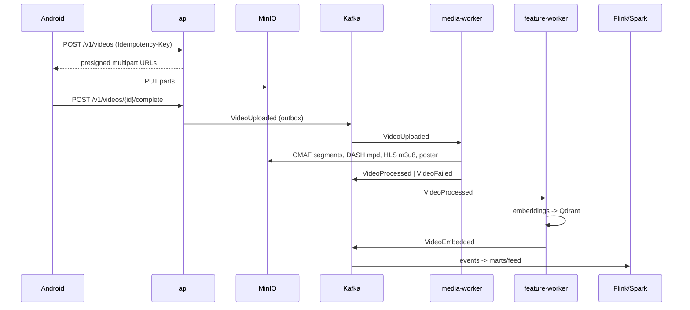

# Workflow: video upload and processing



| Link | Owner | Link check |
| --- | --- | --- |
| Presigned URL, complete, video status | `dotnet-backend` | API + MinIO integration test |
| `VideoUploaded` → renditions/HLS | `video-engineer` | reference videos from `tests/fixtures/videos` |
| `VideoProcessed` → vectors | `ml-engineer` | upsert into Qdrant, stability test |
| Connection to the feed | `data-engineer`, `dotnet-backend` (feed) | the video appeared in a follower's feed |
| Client | `android-dev` | resumable upload, HLS playback |
| Infrastructure | `devops` | `make up` with the lesson's profiles |

## End-to-end check (`make demo`)
1. Upload a reference video via the API.
2. Wait for the `Ready` status (polling with a timeout).
3. Check `manifest.mpd` (DASH) and `master.m3u8` (HLS) — both reference the same CMAF segments.
4. (lesson 8+) Check the point in Qdrant with `model_version`.
5. (lesson 5+) Check it appears in the feed.
6. Resend `VideoUploaded` — state and objects are unchanged (idempotency).
7. Find a single `trace_id` across all services in tracing.

Lessons 1–3: instead of `VideoUploaded` — a job in Postgres (`transcode_jobs`, SKIP LOCKED + LISTEN/NOTIFY), the chain ends with the `ready` status. Each lesson works without the following ones.

## Current layout (after the move to services)
Lesson 1 (current): everything goes through the **gateway** (`:8081`), events — via **outbox + internal HTTP**.

```mermaid
sequenceDiagram
  participant W as web
  participant G as gateway
  participant V as videos
  participant S as MinIO
  participant M as media-worker
  participant A as analysis
  participant AW as analysis-worker
  W->>G: POST /api/videos
  G->>V: create (JWT verified twice)
  V-->>W: presigned PUT
  W->>S: PUT file
  W->>G: POST /api/videos/{id}/complete
  G->>V: uploaded + transcode_jobs (one transaction)
  M->>V: take a job (SKIP LOCKED + lease)
  M->>S: CMAF, DASH mpd, HLS m3u8, poster
  M->>V: ready + outbox video.processed.v1 (one transaction)
  M->>A: POST /internal/v1/events/video-processed (X-Internal-Key; retries with backoff)
  A->>A: analyses: queued (idempotent by video_id)
  AW->>S: download the source
  AW->>A: description: queued -> processing -> done|failed
  W->>G: GET /api/videos/{id}/description
```

| Link | Owner | Link check |
| --- | --- | --- |
| Gateway: JWT, rate limit, routes, `/internal` = 404 | `dotnet-backend` | `GatewayTests` (`AC_gateway_*`) |
| complete → job, video status | `dotnet-backend` | `VideoEndpointsTests`, `PostgresAdaptersTests` |
| Transcoding (a vertical video without SAR → `setsar=1`) | `video-engineer` | `FfmpegArgsBuilderTests`, `FfmpegIntegrationTests` |
| Outbox: exactly one event on `ready`, backoff | `dotnet-backend`, `video-engineer` | `OutboxTests` |
| Event intake, idempotency, validation | `dotnet-backend` | `DescriptionsApiTests` (`AC_analysis_*`) |
| Analysis and description | `video-engineer` (ffmpeg), `ml-engineer` (captioner) | `FfmpegInspectorTests`, `DescriptionComposerTests` |
| Infrastructure | `devops` | `make up`, `make demo` |

`make demo` checks: a vertical 720×1280 video without SAR → Ready (DASH/HLS/poster) → description (up to 90 s) → profile → "my videos" → complete idempotency → 401 without a token, 404 on path traversal and on `/internal` via the gateway.

Diagnosing "description did not appear": `outbox` (`sent_at`, `last_error`) → `analyses` (`status`, `last_error`) → `analysis-worker` logs (runbook — `docs/slo/lesson-01.md`).

Next (lesson 4): the outbox transport → Kafka (the table stays); the chain with `VideoUploaded` described below becomes relevant.

## Additions: social features and separate solutions
- Further along the `ready` chain: the `video.processed.v1` event is received by **two subscribers** — `analysis` (description) and `comments` (registers the video in `known_videos`; without it commenting is impossible). A ready video is visible to any authenticated user and appears in `GET /api/feed` of the author's followers and in the `GET /api/users/{id}/videos` grid.
- Deletion: `DELETE /api/videos/{id}` (owner) → `deleted` + `video.deleted.v1` in outbox (analysis, comments) → MinIO cleanup (`uploads/<id>/…`, `videos/<id>/…`) → the description and comments are deleted by cascade.
- Feed: videos asks users for the internal `GET /internal/v1/users/{id}/following-ids` (20 s cache; users unavailable → only own videos).
- The transcoding worker code — `services/videos/Maksov.VideoService.Videos.MediaWorker` (videos solution, image `Dockerfile.worker`); `make demo` also checks social features (the second user `demo-friend`, follow, feed, comments, deletion).
- Diagnostics: `outbox` (column `subscriber`) → `analyses` / `known_videos` → `analysis-worker` / `comments` logs; runbooks — `docs/slo/lesson-01.md`.
