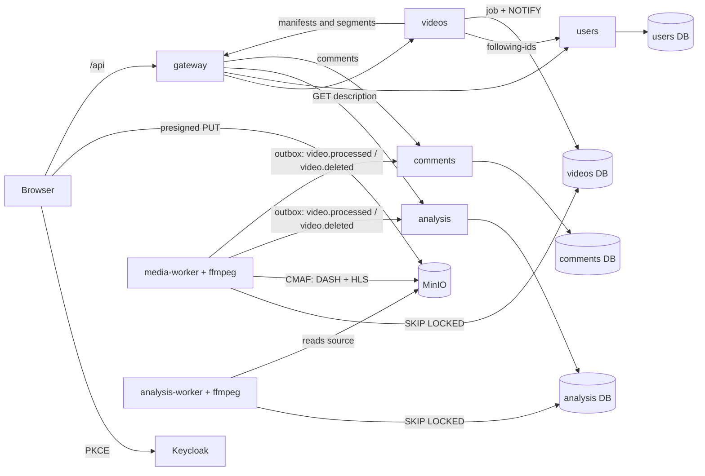

# VideoService

A tutorial series: an Instagram-class video social network on **.NET 11**, fully local.
Each lesson is a git tag `lesson-NN` with working code, tests and the lesson text in [docs/lessons](docs/lessons).

## Quick start

You need: Docker Desktop (≥ 8 GB RAM for the VM; with `make up-ml` ≥ 10 GB), `make`, Node.js 24+ (for `make test-web`), `python3` and `curl` (for `make demo`).
A local .NET SDK is **not required**: builds and tests run in containers.

```bash
make up      # start the stack (first run ~3–5 min: image builds); make env-sync first appends new variables to .env
make demo    # end-to-end scenario: vertical video → Ready → description → profile → follow → feed → comments → deletion
make verify-auth  # sign-in and sign-up in Keycloak: login, e-mail, phone
make pack    # NuGet packages of the shared libraries (needed to build services locally)
make test    # all tests (.NET per solution + web)
make down    # stop and delete data
make up-ml   # (optional) stack with a local vision model for frame captioning
```

> **Secrets are local only.** `make up` runs `scripts/gen-env.sh`, which creates a git-ignored `.env` and fills every password/key (databases, MinIO, Keycloak admin, internal API key, demo user) with random values generated on your machine. Nothing secret is stored in the repository; `.env.example` contains only empty placeholders.

Open http://localhost:3000, sign in as **demo** with the `DEMO_PASSWORD` from your local `.env` — or by phone **+70000000001** with the same password — or sign up (a phone in the format `+79991234567` is required), and upload a video.

> Open the web app via `localhost` or `127.0.0.1` — both are allowed in Keycloak (redirect URI) and in MinIO CORS. Add any other host (for example, a LAN IP) to `deploy/keycloak/realm-videoservice.json` and `WEB_ORIGINS` in `.env`; the realm is imported only into an empty Keycloak — after editing run `make down && make up`.

| Service | Address | Access |
| --- | --- | --- |
| Web "Plyonka" | http://localhost:3000 | `demo` / `DEMO_PASSWORD` from `.env` |
| Gateway (single API entry point) | http://localhost:8081 | Keycloak JWT |
| Keycloak | http://localhost:8080 | admin / from `.env` |
| MinIO Console | http://localhost:9001 | from `.env` |
| PostgreSQL | localhost:5433 | from `.env` (databases `videos`, `users`, `analysis`, `comments`) |
| Ollama (`make up-ml` only) | http://localhost:11434 | no auth, localhost only |

The `videos`, `users`, `analysis`, `comments` services publish no ports — only the gateway talks to them.

### Services

| Service | Folder | Purpose | Storage | CPU / RAM limit |
| --- | --- | --- | --- | --- |
| `web` | `clients/web` | React, nginx | — | 0.25 / 64 MB |
| `gateway` | `services/gateway` | YARP: JWT validation, rate limit, routing | — | 0.75 / 192 MB |
| `videos` | `services/videos` | upload, statuses, "my videos", DASH/HLS delivery, feed, profile grid, deletion | DB `videos`: `videos`, `transcode_jobs`, `outbox` | 1.0 / 256 MB |
| `media-worker` | `services/videos/Maksov.VideoService.Videos.MediaWorker` | CMAF transcoding, outbox delivery to subscribers (part of the videos service) | DB `videos`, MinIO | 2.0 / 1.5 GB |
| `users` | `services/users` | profiles, follows, people search | DB `users`: `profiles`, `follows` | 0.5 / 192 MB |
| `analysis` | `services/analysis` | event intake, description API | DB `analysis`: `analyses` | 0.5 / 256 MB |
| `analysis-worker` | `services/analysis` | ffmpeg video analysis, optional frame captioning | DB `analysis`, MinIO | 1.0 / 768 MB |
| `comments` | `services/comments` | video comments, event intake | DB `comments`: `comments`, `known_videos` | 0.5 / 192 MB |
| `*-migrator` | service images | one-off DB migrations (`videos`, `users`, `analysis`, `comments`) | — | up to 0.5 / 256 MB |
| `postgres` · `minio` · `keycloak` | `deploy/` | infrastructure | — | 1.0 / 512 MB · 1.0 / 512 MB · 1.5 / 1 GB |
| `ollama` (profile `ml`) | — | local vision model | volume `ollama-data` | 4.0 / 4 GB |

## Lesson 1: what works



- Sign-in via Keycloak (OIDC + PKCE) **by login, e-mail or phone**; sign-up with a phone (unique, E.164); Google and Microsoft are connected with `make idps` (keys in `.env`).
- File upload **straight into MinIO** via presigned URL with progress.
- Transcoding into a 240p–1080p ABR ladder, **one set of CMAF segments and two manifests — DASH and HLS**.
- "My videos" with live statuses; Shaka player with DASH/HLS and quality switching.
- **Vertical video (9:16) is the priority**; horizontal is supported ([ADR 0007](docs/adr/0007-vertical-first.md)).
- **Automatic video description:** once a video becomes `ready`, the event reaches the `analysis` service via the outbox; the analysis worker examines the video with ffmpeg tools and builds a text and tags (in Russian).
- **User profile:** name and "about" (`/api/users/me`).

### Social features

| What | How |
| --- | --- |
| Web bottom navigation | "Feed · Search · ＋ · Profile" |
| People search | `GET /api/users?query=` — by login or name prefix, case-insensitive |
| Follows | `PUT` / `DELETE /api/users/{id}/follow` (idempotent, cannot follow yourself) |
| Profile | `GET /api/users/{id}`: login, name, "about", counters, `isFollowing`; video grid — `GET /api/users/{id}/videos` |
| Feed | `GET /api/feed`: ready videos from followed users and your own, newest first; follows from users are cached for 20 s, when users is unavailable — only your own videos |
| Comments | `GET`/`POST /api/videos/{id}/comments`, `DELETE …/{commentId}`: the comment author or the video owner can delete; only ready videos can be commented on (the comments service learns about them from an event, up to 30 s) |
| Deletion | `DELETE /api/videos/{id}` (owner only, 204): cleans up MinIO, description and comments (`video.deleted.v1` event) |
| Visibility | ready videos are visible to any authenticated user; non-ready and deleted ones are not (404) |
| "Interesting videos" | deferred until embeddings and recommendations (lessons 8–9) |

Decisions — [ADR 0009](docs/adr/0009-social-features-comments.md).

### How to view a video description

The description appears a few seconds after `ready`. Statuses: `queued` → `processing` → `done` (or `failed`; this does not affect the video). The owner sees any status, other users only `done`.

```bash
TOKEN=$(curl -s http://localhost:8080/realms/videoservice/protocol/openid-connect/token \
  -d grant_type=password -d client_id=videoservice-cli -d username=demo -d password="$DEMO_PASSWORD" | python3 -c 'import sys,json; print(json.load(sys.stdin)["access_token"])')
curl -s -H "Authorization: Bearer $TOKEN" http://localhost:8081/api/videos/<id>/description
# {"videoId":"…","status":"done","text":"…","tags":["…"],"updatedAt":"…"}
```

The description is a set of "tool readings": scene changes, brightness, saturation, hue, motion, sound and pauses. What is actually depicted becomes known only with the vision model enabled: `make up-ml` starts a local Ollama (default model `moondream`, the first start downloads the model) and captions a few frames. The model is off by default. The same data is shown in the UI, on the video page.

Decisions: [ADR 0001](docs/adr/0001-lesson-01-upload-transcode-watch.md), [0002](docs/adr/0002-cmaf-dash-and-hls.md), [0003](docs/adr/0003-keycloak-identity.md), [0004 — solution structure (partially superseded by 0008)](docs/adr/0004-solution-structure.md), [0005 — phone sign-in](docs/adr/0005-phone-login-keycloak.md), [0006 — services and gateway](docs/adr/0006-microservices-gateway-videos-users-analysis.md), [0007 — vertical video](docs/adr/0007-vertical-first.md), [0008 — separate solutions and NuGet](docs/adr/0008-separate-solutions-nuget.md), [0009 — social features and comments](docs/adr/0009-social-features-comments.md).

Contracts: [public API](contracts/openapi/api.yaml); internal APIs — [analysis](contracts/openapi/internal-analysis.yaml), [comments](contracts/openapi/internal-comments.yaml), [users](contracts/openapi/internal-users.yaml); events — [video.processed.v1](contracts/events/video-processed.v1.json), [video.deleted.v1](contracts/events/video-deleted.v1.json).

## Commands

| Command | What it does |
| --- | --- |
| `make up` / `make down` | start / tear down the stack; `up` depends on `env-sync` |
| `make env-sync` | append to `.env` variables that appeared in `.env.example` (existing values are untouched) |
| `make up-ml` | stack + local vision model (Ollama, profile `ml`) for frame captioning |
| `make demo` | end-to-end scenario: vertical 720×1280 video → Ready → description → profile → second user `demo-friend` → follow → feed → comments → deletion → isolation and `/internal` being closed |
| `make pack` | NuGet packages `libs/*` (`Primitives`, `BuildingBlocks`, `Web`, `TestSupport`) into `artifacts/nuget`, version `0.1.0-local.<hash>` (`VERSION_SUFFIX=ci.42` adds a suffix) |
| `make test` | `test-dotnet` + `test-web` |
| `make test-dotnet` | `make pack`, then tests of each solution (`libs` and services; a temporary Postgres starts automatically; ffmpeg integration runs in a container) |
| `make test-web` | web (vitest) |
| `make lint` | build with `-warnaserror` and `dotnet format` per solution, eslint, tsc |
| `make verify-auth` | Keycloak sign-in/sign-up "as in the browser": login, e-mail, phone, duplicate number, redirect_uri |
| `make idps` | connect Google / Microsoft SSO in Keycloak |
| `make logs s=media-worker` | service logs |

## Structure

```
build/                    shared MSBuild settings: Common.props/targets, Common.Packages.props, global.json and nuget.config templates
libs/                     shared libraries solution (NuGet): Primitives, BuildingBlocks (Postgres, S3, OTel, ProcessRunner, MediaKeys), Web (JWT, HTTP helpers, internal-call key), TestSupport; tests/
artifacts/nuget/          local package feed (make pack; not in git)
services/
  gateway/                YARP gateway: JWT, rate limit, routes (appsettings.json) — its own solution
  videos/                 video service: WebApi · Bll · Dal · Domain · Features.Videos · Features.Feed · MediaWorker (+ tests/)
  users/                  profiles and follows service: WebApi · Bll · Dal · Features.Profiles (+ tests/)
  analysis/               descriptions service: WebApi · Bll · Dal · Features.Descriptions · Worker with ffmpeg (+ tests/)
  comments/               comments service: WebApi · Bll · Dal · Features.Comments (+ tests/)
                          in each service folder: Maksov.VideoService.<Service>.slnx, Directory.*, global.json, nuget.config, Dockerfile
clients/web               React + TypeScript + Vite, Shaka Player
contracts/{openapi,events}  contracts: public and internal APIs, event schemas
deploy/compose            lesson docker-compose
deploy/postgres           init script: a database and role per service
deploy/keycloak           realm, phone sign-in/sign-up provider (Java), theme, SSO script
docs/                     adr, stories, design, security, slo, lessons
scripts/                  demo.sh (end-to-end scenario), verify-auth.py (sign-in and sign-up)
```

### How NuGet packages and the build work

Each service is a separate solution, shared code arrives as packages from the local feed ([ADR 0008](docs/adr/0008-separate-solutions-nuget.md)):

- `make pack` builds `libs/*` into `artifacts/nuget` with version `0.1.0-local.<source hash>`; in services the version is floating (`0.1.0-local.*`), and the service's `nuget.config` points at the feed `../../artifacts/nuget`.
- If you build a service manually (`dotnet build` in `services/<service>`), run `make pack` first, otherwise package restore for `Maksov.VideoService.*` fails. If you changed `libs/`, run `make pack` again.
- The Docker build context is the repository root; the first Dockerfile stage packs `libs/`, the second builds the service.
- The shared .NET version and analyzers come from `build/Common.props`; third-party package versions — from `build/Common.Packages.props`.


## Troubleshooting

| What you need | Where to look |
| --- | --- |
| Why a video has the "defective" status | `docker exec videoservice-postgres-1 psql -U videos -d videos -c "select v.title, v.status, v.failure_reason, j.attempts, j.last_error from videos v left join transcode_jobs j on j.video_id = v.id order by v.created_at desc limit 5;"` — `last_error` holds the full ffmpeg output |
| Service logs | `make logs s=media-worker` (or `gateway`, `videos`, `users`, `analysis`, `analysis-worker`, `comments`, `keycloak`) |
| 401 on `/api/*` with a valid token | the service behind the gateway validates the JWT itself: `make logs s=gateway` and `s=videos`/`users`/`analysis`/`comments`; check issuer/audience (`videoservice-api`) |
| `/internal/**` returns 404 | by design: internal endpoints are not published through the gateway |
| Files in storage | MinIO Console http://localhost:9001 → bucket `media`: `uploads/<id>/source` — the source, `videos/<id>/stream/` — segments and manifests |
| MinIO login/password | `MINIO_ROOT_USER` / `MINIO_ROOT_PASSWORD` from `.env` |
| Keycloak admin | http://localhost:8080 → `KC_BOOTSTRAP_ADMIN_USERNAME` / `KC_BOOTSTRAP_ADMIN_PASSWORD` from `.env` |
| The description did not appear (video `ready`) | 1) was the event sent? in DB `videos`: `select id, attempts, sent_at, last_error from outbox order by created_at desc limit 5;` (one row per subscriber — column `subscriber`; 401 — `INTERNAL_API_KEY` mismatch, connection refused — `analysis` is not up; without `Outbox__Subscribers__<name>__BaseUrl` addresses the dispatcher does not start). 2) accepted and processed? in DB `analysis`: `select video_id, status, attempts, last_error from analyses order by created_at desc limit 5;`. 3) `make logs s=analysis-worker`. Details — [runbook](docs/slo/lesson-01.md) |
| Cannot comment: "video not found" | the comments service registers a video from the `video.processed.v1` event (up to 30 s after `ready`): in DB `videos` — `select subscriber, sent_at, last_error from outbox order by created_at desc limit 5;`, in DB `comments` — `select * from known_videos;`. Details — [runbook](docs/slo/lesson-01.md) |
| The feed is empty | follows (DB `users`, table `follows`), video status (the feed shows only `ready`), follows are cached for 20 s; when `users` is unavailable only your own videos are visible — [runbook](docs/slo/lesson-01.md) |
| `NU1101` / package `Maksov.VideoService.*` not found when building a service | `make pack` (the `artifacts/nuget` feed is empty or stale) |
| `docker compose`: "required variable … is missing" after an update | `make env-sync` (called by `make up`) |
| Retry processing of a failed video | `update videos set status='uploaded', failure_reason=null where id='…'; update transcode_jobs set status='queued', attempts=0, run_after=now(), locked_until=null, locked_by=null where video_id='…'; select pg_notify('transcode_jobs','retry');` |

## Resources

Limits are set for every container; the total without Ollama is ≈ 10 CPU / 5.4 GB RAM (with `make up-ml` — another 4 CPU / 4 GB) (details — [docs/slo/lesson-01.md](docs/slo/lesson-01.md)).

## Web development without Docker

```bash
make up                       # backend in containers
cd clients/web && npm ci && npm run dev   # http://localhost:5173, /api is proxied to :8081
```

## Configuration

All configuration is via environment variables; the template is [.env.example](.env.example) (`make up` appends missing variables to `.env`: `make env-sync`). Secrets are not committed to the repository.

> MinIO no longer publishes official images to Docker Hub/Quay. A Chainguard build pinned by digest is used; it can be replaced with the `MINIO_IMAGE` variable.
