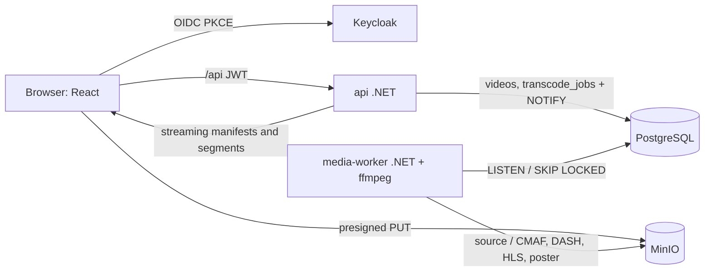

# 0001. Lesson 1: uploading, transcoding, and watching your own videos

- **Status:** Accepted
- **Date:** 2026-11-15
- **Lesson / feature:** lesson-01 / upload-transcode-watch

> The architecture was extended in [ADR 0006](0006-microservices-gateway-videos-users-analysis.md): the single API was split into a gateway and the videos, users, and analysis services.

## Context
The first application of the series: a user signs in, uploads a video, it is transcoded into an ABR ladder and becomes available for viewing; the user sees a list of their videos. Constraints: local only, 16 GB / 8 CPU for the whole future stack, each lesson works without the following ones (Kafka appears in lesson 4).

## Decision

1. **Upload directly to MinIO** via presigned PUT (TTL 15 min, fixed key and Content-Type). The API does not proxy the file bytes.
2. **Complete**: the API verifies the object (`HEAD`), and in one transaction moves the video to `uploaded`, enqueues a task in `transcode_jobs`, and calls `pg_notify`.
3. **Postgres-based queue**: `FOR UPDATE SKIP LOCKED` + lease (`locked_until`) + `LISTEN/NOTIFY` for wake-up (fallback polling every 15 s). The `IJobQueue` port in the worker → in lesson 4 the adapter is swapped for Kafka without changing the slice.
4. **Transcoding**: a single ffmpeg pass, CMAF segments + DASH and HLS manifests (ADR 0002).
5. **Playback**: the API streams manifests/segments from MinIO after checking the owner (check cached for 60 s).
6. **Authorization**: Keycloak, JWT in the API (ADR 0003).
7. **Code style**: Hexagonal + Vertical Slice (see the architecture rules); shared libraries `libs/*` are packaged as NuGet.

## Alternatives considered
| Option | Pros | Cons | Why rejected |
| --- | --- | --- | --- |
| Upload through the API (multipart in .NET) | Simpler client | Bytes go through the API: memory, CPU, timeouts | Does not scale, contradicts resource economy |
| Kafka already in lesson 1 | "Right" from the start | +1 GB RAM, schema registry, outbox — overloads the first lesson | Lesson 4 is entirely about events; the queue port makes the swap cheap |
| Redis/RabbitMQ as the queue | Ready-made queue | Another service and "DB + broker" consistency (dual write) | Postgres is already there, the task is enqueued in the same transaction |
| Public bucket for media | No load on the API | Videos accessible to anyone with the link | The lesson is about "my videos"; privacy matters more. Later — nginx `secure_link`/CDN signing |
| Presigned URL per segment | API not in the data path | Manifests must be rewritten on the fly, URLs expire during playback | Complex; revisit when a CDN appears |

## Load estimate (learning scale)
1,000 uploads/day × 1 min ≈ 17 h of transcoding on 2 CPU at `veryfast` ≈ 1× real time → 1 worker is enough. Storage: ~(0.4+0.8+1.4+2.8+5.0) Mbit/s ≈ 10.4 Mbit/s ≈ 78 MB per minute of video + the source. Delivery: 4 s segment, ~1 request per 4 s per viewer — owner check served from cache, bytes streamed without buffering.

## Affected services and events
- Services: `api` (new), `media-worker` (new), `web` (new), Keycloak, MinIO, PostgreSQL.
- `api` slices: `CreateUpload`, `CompleteUpload`, `ListMyVideos`, `GetVideo`, `StreamMedia`. `media-worker` slice: `Transcode`.
- Ports/adapters: `IVideoRepository`→Postgres, `IObjectStorage`→S3/MinIO, `IJobQueue`→Postgres, `IMediaProbe`→ffprobe, `ITranscoder`→ffmpeg.
- Kafka events: none (lesson 4: `VideoUploaded`, `VideoProcessed`, `VideoFailed`).
- Storage: `videos`, `transcode_jobs`; bucket `media` (`uploads/`, `videos/`).

## Threats (for security)
IDOR when reading other users' videos; Content-Type/size spoofing on upload; video bombs and SSRF via ffmpeg (HLS/concat); path traversal in segment delivery; abuse of upload creation. Mitigations — in `docs/security/threat-model-lesson-01.md`.

## Consequences
- (+) Everything starts with one command, the file does not pass through the API, reprocessing is safe.
- (−) The API is in the segment delivery path: as load grows, move delivery to nginx with `auth_request`/`secure_link`.
- (−) A single PUT is limited to 5 GB and cannot be resumed — resumable multipart in lesson 2.

## Next steps
- [x] analyst: `contracts/openapi/api.yaml`, `docs/stories/lesson-01-upload.md`
- [x] dba: `0001_init.sql` (+ down)
- [x] devops: compose, Makefile, NuGet
- [x] security: threat model
- [x] sre: SLO, limits
- [x] designer: `docs/design/principles.md`
