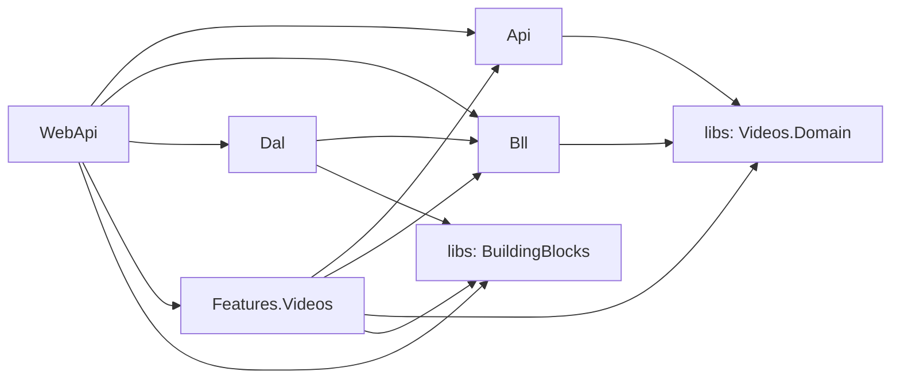

# 0004. .NET solution structure: solution files in `services/`, web API built from shared and per-feature assemblies

- **Status:** Accepted; **partially superseded by [ADR 0008](0008-separate-solutions-nuget.md)** (items 1, 3–5 on the single `services/` solution and shared libraries; item 2 — the `Maksov.VideoService.` prefix — remains in force)
- **Date:** 2026-11-15
- **Lesson / feature:** lesson-01 (structure refactoring)
- **Extended by:** [ADR 0006](0006-microservices-gateway-videos-users-analysis.md) — the backend was split into the services `gateway`, `videos`, `users`, `analysis`; the `services/api` web API was replaced by services with the structure `WebApi · Bll · Dal · Features.<Area>` (laid out under `services/<service>/`), and the shared web layer `Api` moved to `services/libs/Maksov.VideoService.Web`. The rules on solution files and the prefix (items 1–2, 5) remain in force.

## Context
First version: the solution files (`*.slnx`, `Directory.*`, `global.json`, `nuget.config`, `.editorconfig`) lived in the repository root next to `docs/`, `deploy/`, `clients/`, `Makefile`; the web API was a single assembly `VideoService.Api` with `Features/`, `Ports/`, `Adapters/` folders. This blurs boundaries: the root is cluttered with .NET service files, and "per-feature" structure exists only as folders inside one assembly.

## Decision
1. **The .NET root is `services/`.** Everything belonging to the solution lives there: `Maksov.VideoService.slnx`, `Directory.Build.props|targets`, `Directory.Packages.props`, `global.json`, `nuget.config`, `.editorconfig`, `.dockerignore`. The repository root holds only cross-service items: `Makefile`, `README.md`, `docs/`, `contracts/`, `deploy/`, `clients/`, `scripts/`.
2. **The `Maksov.VideoService.` prefix** on all assemblies, namespaces, and NuGet packages.
3. **The web API (`services/api/`)** is split into assemblies:
   - `WebApi` — the host (composition root: `Program.cs`, Keycloak JWT, rate limit, health, `--migrate`/`--health` commands);
   - `Api` — the shared web layer (HTTP helpers, error mapping, policy names);
   - `Bll` — ports and shared business logic;
   - `Dal` — port adapters (Postgres/Dapper) and SQL migrations;
   - `Features.<Area>` — one assembly per area (currently `Features.Videos`) with the slices `CreateUpload`, `CompleteUpload`, `ListMyVideos`, `GetVideo`, `StreamMedia`.
4. **Shared libraries** for multiple services — `services/libs/` (`BuildingBlocks`, `Videos.Domain`), packaged as NuGet.
5. The dependency graph is fixed in the architecture rules: features do not reference `Dal`, `WebApi`, or each other.

## Alternatives considered
| Option | Why rejected |
| --- | --- |
| Everything in one `Api` assembly (as it was) | Feature/layer boundaries are not enforced by the compiler; coupling grows |
| Classic `Web/Application/Domain/Infrastructure` layers without feature assemblies | Contradicts Vertical Slice: adding a feature touches all layers |
| A separate solution per service (`services/api/*.slnx`, `services/media-worker/*.slnx`) | Duplicated `Directory.*`/`global.json`, version drift; shared `libs` would have to be consumed via NuGet already in lesson 1 |
| Solution files stay in the root | Violates the requirement "the solution and its files next to the projects" |

## Consequences
- (+) The compiler enforces boundaries: a feature physically cannot reference `Dal`.
- (+) A new feature = a new assembly + two lines in `Program.cs`.
- (−) More csproj files; the Docker build context is now `services/`.

## Next steps
- [x] dotnet-backend: move and split assemblies, tests green
- [x] devops: Dockerfiles, compose, Makefile for the `services/` context
- [ ] qa: architecture test (NetArchTest) on the dependency graph — lesson 2
