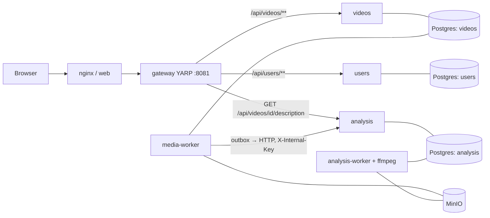

# 0006. Multiple services: gateway, videos, users, analysis

- **Status:** Accepted
- **Date:** 2026-11-15
- **Lesson / feature:** lesson-01 (backend restructuring)
- **Extends:** [ADR 0004](0004-solution-structure.md) (solution structure), [ADR 0003](0003-keycloak-identity.md) (identity)
- **Service list update:** later ADRs added the services `comments` ([ADR 0009](0009-social-features-comments.md)), `friends` and `feed` (lesson 2, [ADR 0010](0010-friends-and-feed-services.md)); the gateway, DB-per-service and outbox decisions below apply to all of them.
- **Extended by:** [ADR 0008](0008-separate-solutions-nuget.md) (separate solutions and NuGet layout: project paths below are updated), [ADR 0009](0009-social-features-comments.md) (`comments` service, outbox subscribers, social features)

## Context
The first version of the backend was a single web API (`services/api`) plus a transcoding worker. User profiles and automatic video descriptions are about to be added. The description is built by a heavy background process (ffmpeg over the whole video, optionally a vision model) with different requirements for resources, reliability and release speed than the API. The rest of the series introduces Kafka, the feed and stream processing: service boundaries are needed up front, otherwise they would have to be carved out of a running system later.

## Decision
The backend consists of a user-facing gateway and three services with their own databases.

1. **gateway** (`services/gateway`, YARP, host port 8081) — the only public backend entry point. Validates Keycloak JWTs, applies rate limiting (upload creation ≤ 20/min per user), and routes using the `ReverseProxy` table in `appsettings.json`. `/internal/**` is not published externally (404). The authorization policy is named `authenticated`: the name `default` is reserved in YARP.
2. **videos** (`services/videos`) — upload, statuses, listing, serving manifests and segments; the **media-worker** (`services/videos/Maksov.VideoService.Videos.MediaWorker`) is part of it: transcoding to CMAF (DASH + HLS). Database `videos`: `videos`, `transcode_jobs`, `outbox`.
3. **users** (`services/users`) — profiles (`GET/PUT /api/users/me`, `GET /api/users/{id}`). Database `users`, table `profiles`. Identity and passwords remain in Keycloak.
4. **analysis** (`services/analysis`) — description API and a separate **analysis-worker** (its own image with ffmpeg). Database `analysis`, table `analyses` (also the queue: `SKIP LOCKED` + lease + `LISTEN/NOTIFY`).
5. **videos → subscribers (analysis, later comments too) uses a transactional outbox + internal HTTP.** When a video becomes `ready`, the `video.processed.v1` event ([schema](../../contracts/events/video-processed.v1.json)) is written to `outbox` in the same transaction. `OutboxDispatcher` in media-worker (LISTEN/NOTIFY + fallback polling every 30 s, retries with backoff 5 s … 5 min) sends it to `POST /internal/v1/events/video-processed` ([contract](../../contracts/openapi/internal-analysis.yaml)) with the `X-Internal-Key` header. Handling is idempotent by `video_id`. Without `Outbox__AnalysisBaseUrl` the dispatcher is disabled.
6. **Zero trust inside the network:** every service behind the gateway validates the JWT itself; internal endpoints are protected by the shared key `INTERNAL_API_KEY`.
7. **Database per service.** One PostgreSQL instance, but each service has its own DB and role (`deploy/postgres/init/00-databases.sh`; passwords `VIDEOS_DB_PASSWORD`, `USERS_DB_PASSWORD`, `ANALYSIS_DB_PASSWORD`). Each service has its own migrator (`--migrate`) and its own migrations table.
8. **Service structure:** `WebApi` (host) · `Bll` (ports) · `Dal` (Postgres adapters + migrations) · `Features.<Area>` (slices). The shared web layer is the library `libs/Maksov.VideoService.Web` (previously the `Api` assembly inside the web API). The shared libraries `Primitives`, `BuildingBlocks`, `Web`, `TestSupport` are packed into NuGet (`make pack`), see [ADR 0008](0008-separate-solutions-nuget.md); `Videos.Domain` is a project inside the videos service.
9. **An analysis failure does not affect the video:** the video is already `ready`; the description is an additional property.

## Alternatives considered
| Option | Why rejected |
| --- | --- |
| Monolith with modules (one process, schemas in one DB) | Heavy analysis shares the process and memory limits with the API; boundaries for Kafka and the feed would have to be carved out later; modules easily grow together through a shared DB |
| Kafka right away | Lesson 1 must start quickly on a modest machine; the broker and Schema Registry are the topic of lesson 4. The outbox makes the transition a transport swap rather than a rewrite |
| Direct videos → analysis calls without an outbox | Dual write: the `ready` status and the call are not atomic, a crash between them loses the description; no retries or backoff |
| Shared DB access (analysis reads videos tables) | Hidden schema coupling, a service's storage cannot be changed independently, no clear data owner |

## Consequences
- (+) Heavy work is isolated: own image, limits, scaling; an analysis outage does not break upload and playback.
- (+) Consistency between videos and analysis is ensured by the outbox: the event is neither lost nor created without a status change.
- (+) Service data is independent (DB-per-service); a service cannot be broken by another's migration.
- (−) More containers: the sum of limits without Ollama ≈ 9.5 CPU / 5.2 GB (details in [docs/slo/lesson-01.md](../slo/lesson-01.md)).
- (−) Eventual consistency: the description appears a few seconds after `ready`; the client polls `GET /api/videos/{id}/description`.
- (−) At-least-once delivery: the handler must be idempotent (handling by `video_id`, deduplication by `event_id`).
- (−) No shared transaction or JOIN across services: author profiles in lists will require aggregation at the gateway or in the client.

## Next steps
- [ ] Lesson 4: outbox transport → Kafka (Redpanda) + Schema Registry; the `outbox` table stays, the schema format (JSON Schema → Avro) is fixed in a separate ADR.
- [ ] Phone confirmation (local SMS provider) — see residual risks in [ADR 0005](0005-phone-login-keycloak.md).
- [ ] Architecture test (NetArchTest) on the assembly dependency graph.
- [ ] Cross-service observability (trace_id from the event into analysis logs) — lesson 12.
