# 0008. Separate solutions per service, shared libraries as NuGet packages

- **Status:** Accepted
- **Date:** 2026-11-15
- **Lesson / feature:** lesson-01 (repository structure)
- **Partially supersedes:** [ADR 0004](0004-solution-structure.md) (single solution in `services/`); keeps the `Maksov.VideoService.` prefix
- **Related:** [ADR 0006](0006-microservices-gateway-videos-users-analysis.md) (services and DB-per-service)

## Context
After the move to multiple services ([ADR 0006](0006-microservices-gateway-videos-users-analysis.md)), the single solution `services/Maksov.VideoService.slnx` with shared `Directory.*` files coupled the services at build level: changing any project rebuilt everything, shared libraries were consumed as `ProjectReference`, one test run mixed other services in, and a service's Docker image pulled in its neighbors' sources. A service that "lives" separately (own DB, own image, own release) must be built and tested separately.

## Decision
1. **Each service has its own solution** in its own folder: `services/<svc>/Maksov.VideoService.<Svc>.slnx` (`gateway`, `videos`, `users`, `analysis`, `comments`, `friends`, `feed`; the last two were added in lesson 2 by [ADR 0010](0010-friends-and-feed-services.md)) with its own `Directory.Build.props|targets`, `Directory.Packages.props`, `global.json`, `nuget.config`. Service tests live in `services/<svc>/tests/` and belong to its solution. There are no more shared test projects at the `services/` level.
2. **Shared MSBuild settings live in `build/`:** `Common.props` (target framework, analyzers, package version `0.1.0`), `Common.targets`, `Common.Packages.props` (versions of third-party packages and shared libraries for all solutions), templates `global.json.template` and `nuget.config.template`. A solution's `Directory.*` files merely import these — a single point for updating .NET and versions. The root `.editorconfig` is shared.
3. **Shared libraries are a separate solution `libs/`** (`Maksov.VideoService.Libs.slnx`): `Primitives` (Result, DomainError), `BuildingBlocks` (Postgres/SqlMigrator, S3/MinIO, OpenTelemetry, ProcessRunner, `MediaKeys`), `Web` (Keycloak JWT, HTTP helpers, health, internal-call key), `TestSupport` (test authentication, temporary DBs). Library tests are in `libs/tests`.
4. **Libraries reach services as NuGet packages, not project references.** `make pack` builds them into the local feed `artifacts/nuget` (not committed to git); the version is `0.1.0-local.<hash of libs and build sources>` (if needed, `VERSION_SUFFIX` appends a suffix, e.g. `ci.42`). In `Common.Packages.props` the version is floating (`0.1.0-local.*`); each service's `nuget.config` adds the feed `../../artifacts/nuget` and maps `Maksov.VideoService.*` packages to it only.
5. **The Docker build context is the repository root.** The first Dockerfile stage (`libs`) packs `libs/` into `/feed` with a version derived from the source hash; the second (`build`) copies `build/`, the feed and a single service's folder and runs `dotnet publish`. A service does not see its neighbors' sources, and a library change yields a new package version, so the NuGet cache never serves a stale one.
6. **`Videos.Domain` is a project inside `services/videos`** (statuses, `UploadPolicy`, `RenditionLadder`, `VideoEvents` events), not a shared library: it is one service's domain. The transcoding worker is `services/videos/Maksov.VideoService.Videos.MediaWorker` (part of the videos solution, own `Dockerfile.worker`). `MediaKeys` (MinIO key rules) moved to `BuildingBlocks` because both videos and analysis use it.
7. **Make commands operate per solution:** `make pack` → `make test-dotnet` (packs libraries, starts a temporary Postgres and runs the tests of `libs` and every service) → `make lint` (build with `-warnaserror` and `dotnet format` per solution).

```mermaid
flowchart LR
  subgraph build[build/]
    C[Common.props / targets / Packages]
  end
  subgraph libs[libs/ — solution]
    P[Primitives] --> W[Web]
    BB[BuildingBlocks]
    TS[TestSupport]
  end
  libs -- make pack --> F[(artifacts/nuget)]
  F -- PackageReference --> S1[videos]
  F --> S2[users]
  F --> S3[analysis]
  F --> S4[comments]
  F --> S6[friends]
  F --> S7[feed]
  F --> S5[gateway]
  C -.-> libs
  C -.-> S1 & S2 & S3 & S4 & S5
```

## Alternatives considered
| Option | Why rejected |
| --- | --- |
| Single solution in `services/` (ADR 0004) | Services are coupled by build and tests, the image pulls in others' sources, shared `Directory.*` prevents a service from having its own dependency versions |
| Separate solutions, libraries via `ProjectReference` to `../../libs` | A service project depends on libs sources: the Docker context and image include the whole folder; no library versioning and no sense of "what changed for the consumer" |
| Shared libraries as copy-paste in services | Behavior drift (JWT, migrations, storage), bugs fixed N times |
| Publishing to a remote NuGet feed | Violates the "local only" rule; the local feed `artifacts/nuget` is enough |
| One `Directory.*` at the root of `services/` | Brings coupling back; shared parts are moved to `build/` and imported explicitly |

## Consequences
- (+) A service is built, tested and packaged into an image independently; changes in a neighbor do not affect it.
- (+) Boundaries between services and libraries are enforced by the build: a service cannot reference a neighbor's project.
- (+) The libs version is deterministic by source hash; Docker and NuGet caches do not serve a stale package.
- (−) `make pack` is required before building a service locally (otherwise there is no feed); editing a library means rebuilding the package and restoring in services.
- (−) Several `slnx`, `global.json`, `nuget.config` files (copies of templates from `build/`) — when changing .NET, edit the template and the solutions' files; `Common.props` remains the single point for the framework version.
- (−) Image builds are longer by the first stage (libs packages), mitigated by layer and NuGet caches.

## Next steps
- [x] Move services and libraries, `make pack` / `make test-dotnet` / `make lint` per solution
- [x] Dockerfiles with the first `libs` stage, context is the repository root
- [ ] Architecture test (NetArchTest) on assembly dependencies within a service
- [ ] CI: `make pack` with `VERSION_SUFFIX=ci.<number>` and a shared package cache
