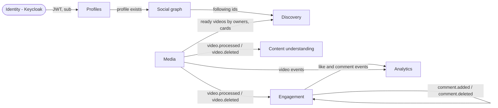

# Domain map

Services are derived from domains (bounded contexts), not the other way round. This page is the context map; each domain with
its own life cycle gets a page `docs/domains/<domain>.md` when it is designed.

## Domains

| Domain | Type | Language (key terms) | Services | Owns data |
| --- | --- | --- | --- | --- |
| Identity | generic | account, credentials, SSO | Keycloak | accounts, sessions |
| Profiles | supporting | profile, username, display name | `users` | profiles |
| Social graph | supporting | follow, follower, mutual, recommendation | `friends` | follows, user embeddings |
| Media | core | upload, transcode, rendition, playback | `videos`, `media-worker` | videos, jobs, media files (MinIO) |
| Content understanding | supporting | analysis, description, tags | `analysis`, `analysis-worker` | analyses |
| [Engagement](engagement.md) | core | like, comment, liker | `likes`, `comments` | likes, counters, comments |
| Discovery | core | feed, card, recommendation | `feed` (now), recommendations (lessons 10-11) | nothing yet (stateless) |
| Analytics | supporting | event, bronze/silver/gold, mart | `lake-ingest` (lesson 4), Flink/Spark (lessons 8-9) | the data lake |

## Context map

## Rules

- A service belongs to exactly one domain and owns its data (DB-per-service); other domains see it through contracts or replicas fed by events.
- Anything that crosses a domain boundary is an API contract (`contracts/openapi/`) or an event (`contracts/events/`).
- Every business fact analytics or recommendations may need (views, likes, comments, follows) is published as an event for the data lake.
- Generic domains are configured or bought (Keycloak, MinIO), not built.
