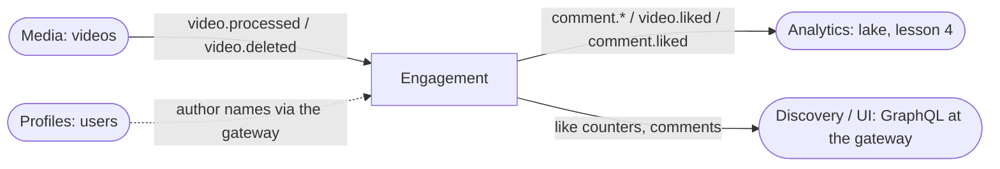

# Domain: Engagement

> Part of the [domain map](README.md). Decisions: [ADR 0009](../adr/0009-social-features-comments.md) (comments), [ADR 0011](../adr/0011-likes-service-and-domain-events.md) (likes and domain events), [ADR 0012](../adr/0012-graphql-at-the-gateway.md) (GraphQL composition). Lesson: [3](../lessons/03-likes-events-graphql.md).

**Purpose.** Capture how people react to content — they like it and discuss it — and turn each reaction into a business fact that the rest of the system (and later the data lake and recommendations) can use. The domain is *core*: reactions are the product's first behaviour signals.

## Ubiquitous language

| Term | Meaning |
| --- | --- |
| Target | what a reaction is about: a **video** or a **comment** |
| Like | the fact "user U likes target T"; at most one per (target, user); liking again changes nothing |
| Unlike | removal of a like; changes nothing if there is none |
| Liker | a user who liked a target (listed newest first) |
| Like count | number of likes of a target; always read together with `likedByMe` for the viewer |
| Comment | a text (1–500 characters) written by a user under a video |
| Author / video owner | the author wrote the comment; the owner published the video — either may delete the comment |
| Known video / known comment | a local replica (id and owner/author) fed by events, so that a service can answer "does it exist" without calling another service |

## Aggregates, invariants and owners

| Aggregate | Service | Invariants |
| --- | --- | --- |
| Like (`target_type`, `target_id`, `user_id`) + its counter | `likes` (DB `likes`) | one like per (target, user); the counter changes in the same transaction as the like row; only targets known from events can be liked (video not deleted; comment belongs to the stated video) |
| Comment | `comments` (DB `comments`) | text 1–500 characters, trimmed; the video must be known (registered by `video.processed.v1`) and not deleted; delete only by author or video owner (someone else's → 404) |
| Known video / comment (replicas) | `likes` (`known_videos`, `known_comments`), `comments` (`known_videos`) | filled only by internal event intake; a deleted video stays as a tombstone so a late `video.processed.v1` cannot revive it |

## Commands (public API, through the gateway or GraphQL)

| Command | Route | Result |
| --- | --- | --- |
| Like / unlike a video | `PUT/DELETE /api/videos/{id}/like` (GraphQL `likeVideo`, `unlikeVideo`) | 204 idempotent; unknown or deleted video → 404 |
| Like / unlike a comment | `PUT/DELETE /api/videos/{id}/comments/{commentId}/like` (`likeComment`, `unlikeComment`) | 204 idempotent; unknown comment → 404 |
| Add a comment | `POST /api/videos/{id}/comments` (`addComment`) | 201 with the comment |
| Delete a comment | `DELETE /api/videos/{id}/comments/{commentId}` (`deleteComment`) | 204; author or video owner |

Queries: like counters by ids (`GET /api/likes/videos|comments?ids=`, max 50), likers (`GET /api/videos/{id}/likes`), comments list. Contracts: [api.yaml](../../contracts/openapi/api.yaml), [gateway.graphql](../../contracts/graphql/gateway.graphql).

## Events

| Event | Producer | Subscribers | Meaning |
| --- | --- | --- | --- |
| [`comment.added.v1`](../../contracts/events/comment-added.v1.json) | comments | likes, lake | a comment was created (carries `textLength`, **never the text**) |
| [`comment.deleted.v1`](../../contracts/events/comment-deleted.v1.json) | comments | likes, lake | a comment was deleted by its author or the video owner (`deletedBy`) |
| [`video.liked.v1`](../../contracts/events/video-liked.v1.json) / [`video.unliked.v1`](../../contracts/events/video-unliked.v1.json) | likes | lake | a like of a video appeared / disappeared |
| [`comment.liked.v1`](../../contracts/events/comment-liked.v1.json) / [`comment.unliked.v1`](../../contracts/events/comment-unliked.v1.json) | likes | lake | a like of a comment appeared / disappeared |

Consumed from the Media domain: [`video.processed.v1`](../../contracts/events/video-processed.v1.json) (makes a video likeable and commentable) and [`video.deleted.v1`](../../contracts/events/video-deleted.v1.json) (removes the video's comments, likes and counters; the lake learns about the cascade from this one event, there are no per-comment events). Every event carries `eventId`, `occurredAt`, `schemaVersion`, `traceId`; receivers are idempotent. Delivery is the transactional outbox (one row per event and subscriber) plus internal HTTP; the `lake` rows wait as a backlog until lesson 4 configures that subscriber.

## Context map (relations)

- **Upstream:** Media (the facts "a video is ready" and "a video was deleted"); Identity (the user id from the token).
- **Downstream:** Analytics (all reactions as events), the web client and GraphQL (counters, likers, comments composed with cards and profiles).
- **Anti-corruption by replicas:** `likes` and `comments` never call `videos` at request time; they keep `known_videos` (and `likes` also `known_comments`) fed by events, accepting eventual consistency (a video becomes likeable and commentable after its `processed` event is delivered).
- **Not in this domain:** follows (Social graph, `friends`), feed assembly (Discovery, `feed`), moderation (not built).

## Services derived from the domain

| Service | Why separate |
| --- | --- |
| `likes` | a tiny, very write-heavy fact with counters and its own scaling; owns likes, counters and replicas |
| `comments` | content with its own text, life cycle and deletion rules; was introduced in lesson 1 and gained domain events in lesson 3 |

Both run an in-process outbox dispatcher from the shared outbox library in `libs/BuildingBlocks` ([ADR 0011](../adr/0011-likes-service-and-domain-events.md)).
