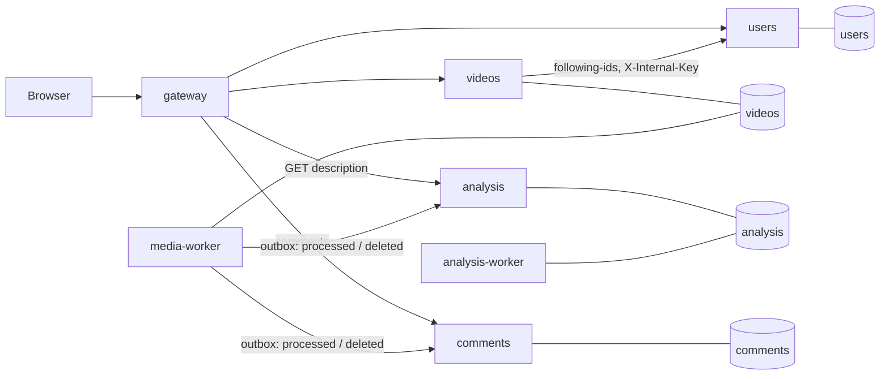

# Lesson 1. Video upload, transcoding to DASH and HLS, profiles, feed and comments

> This text describes the state at the git tag `lesson-01`: follows live in `users`, the feed is built in `videos`. The `friends` and `feed` services and pgvector arrive in [lesson 2](02-friends-feed-pgvector.md).

> Tag: `lesson-01` · Time: ~3–4 h

## Goal
Build the first working video-service application out of several services behind a single gateway (each service has its own solution, shared libraries are NuGet packages): Keycloak sign-in, video upload (vertical 9:16 is the reference) straight into object storage, background transcoding into an adaptive stream, automatic video description by a separate service, a user profile and watching your own videos in the browser.

## Result
```bash
make up && make demo
# ...
# ▸ Waiting for Ready (up to 120 s)
#   ✓ ready in ~8 s: 240p, 360p, 480p, 720p
# ▸ DASH manifest
#   ✓ Representation: 5
# ▸ Video description — a separate background job of the analysis service
#   ✓ ready: …
# ▸ Follow → video in the friend's feed
# ▸ Comments: the separate comments service
# ▸ Deletion: MinIO, description, comments
# Demo passed.
```
In the browser: http://localhost:3000 → "＋" → the video appears in "My videos" and plays in DASH and HLS with quality switching; "Search" → find demo-friend and follow → the friend's videos in "Feed" → a comment under a video → "Profile".

## Prerequisites
Docker Desktop (≥ 8 GB RAM; with `make up-ml` ≥ 10 GB), `make`, Node.js 24+, `python3`, `curl`. A local .NET SDK is not needed.

## Architecture
Decisions: [ADR 0001](../adr/0001-lesson-01-upload-transcode-watch.md), [0006 — services and gateway](../adr/0006-microservices-gateway-videos-users-analysis.md), [0007 — vertical video](../adr/0007-vertical-first.md), [0008 — separate solutions and NuGet](../adr/0008-separate-solutions-nuget.md), [0009 — social features and comments](../adr/0009-social-features-comments.md).



Key ideas:
1. File bytes **do not go through the API** — the browser puts them into MinIO via a presigned URL.
2. A single entry point — the **gateway** (YARP): JWT validation, rate limit, routing. Services behind it validate the JWT again.
3. Job enqueueing and the event happen **in the same transaction** as the status change (no dual write).
4. The queue is **Postgres** (`SKIP LOCKED` + lease + `LISTEN/NOTIFY`) behind a port; in lesson 4 we swap it for Kafka.
5. We encode **once** into CMAF and serve **DASH and HLS** ([ADR 0002](../adr/0002-cmaf-dash-and-hls.md)).
6. **A database per service**; services communicate through the outbox (a row per subscriber) and internal HTTP, not through shared tables.
7. **Separate solutions:** each service has its own solution, shared libraries arrive as NuGet packages (`make pack`).
8. Videos are **vertical** (9:16) by default; horizontal ones work too.
9. Ready videos are visible to any authenticated user; the feed is built from follows.

## Repository layout and NuGet
```
build/                    shared MSBuild settings: Common.props/targets, Common.Packages.props, global.json and nuget.config templates
libs/                     libraries solution: Primitives, BuildingBlocks, Web, TestSupport (+ tests/)
services/<svc>/           own solution Maksov.VideoService.<Svc>.slnx, Directory.*, global.json, nuget.config, Dockerfile, tests/
                          (gateway, videos, users, analysis, comments)
artifacts/nuget/          local package feed (not in git)
```
`make pack` builds `libs/*` into `artifacts/nuget` with version `0.1.0-local.<source hash>`; the service's `nuget.config` points at this feed, and the version in [Common.Packages.props](../../build/Common.Packages.props) is floating (`0.1.0-local.*`). The service Dockerfile (context — repository root) packs libs in the first stage and builds the service in the second — for example [services/videos/Dockerfile](../../services/videos/Dockerfile). The shared .NET version and analyzers are set by [build/Common.props](../../build/Common.props). Details and alternatives — [ADR 0008](../adr/0008-separate-solutions-nuget.md).

## Step-by-step walkthrough

### Step 1. Structure: Hexagonal + Vertical Slice
Each HTTP service has four layers: `WebApi` (host), `Bll` (ports), `Dal` (Postgres adapters and migrations), `Features.<Area>` (slices). A use case is a slice folder: endpoint and handler in [CreateUpload.cs](../../services/videos/Maksov.VideoService.Videos.Features.Videos/CreateUpload/CreateUpload.cs). The handler depends only on ports ([IVideoRepository](../../services/videos/Maksov.VideoService.Videos.Bll/Ports/IVideoRepository.cs), [IObjectStorage](../../libs/Maksov.VideoService.BuildingBlocks/Storage/IObjectStorage.cs)). Shared code lives in `libs/` ([Web](../../libs/Maksov.VideoService.Web/HttpExtensions.cs): JWT, HTTP helpers, internal-call key); the video domain is the [Videos.Domain](../../services/videos/Maksov.VideoService.Videos.Domain/RenditionLadder.cs) project inside the service.

### Step 2. Keycloak and the gateway
The realm is imported from [realm-videoservice.json](../../deploy/keycloak/realm-videoservice.json): a public client with PKCE for the web app, an audience mapper for the API. The [gateway](../../services/gateway/Maksov.VideoService.Gateway/Program.cs) validates the JWT ([KeycloakAuthExtensions.cs](../../libs/Maksov.VideoService.Web/KeycloakAuthExtensions.cs)) and routes using the `ReverseProxy` table from [appsettings.json](../../services/gateway/Maksov.VideoService.Gateway/appsettings.json): `GET /api/videos/{id}/description` → analysis, `/api/videos/{id}/comments/**` → comments, `GET /api/feed` and `GET /api/users/{id}/videos` → videos, `/api/videos/**` → videos, `/api/users/**` → users. Upload creation is limited to 20/min per user. `/internal/**` is not routed (404). A Docker subtlety: the browser sees `localhost:8080` while services see `keycloak:8080`, so `MetadataAddress` is internal and `ValidIssuer` is public. A YARP subtlety: the authorization policy is named `authenticated` because the name `default` is reserved in YARP.

### Step 3. Presigned upload
`POST /api/videos` creates a record and returns a signed PUT. The signature includes `Host`, so the presigned URL is signed with MinIO's **public** address by a separate client ([S3ObjectStorage.cs](../../libs/Maksov.VideoService.BuildingBlocks/Storage/S3ObjectStorage.cs)). The browser uploads the file via `XMLHttpRequest` for progress ([putFile.ts](../../clients/web/src/features/upload/putFile.ts)).

### Step 4. Complete and the queue
`POST /complete` checks the object (`HEAD`), then in one transaction: `uploaded` + `insert transcode_jobs` + `pg_notify` ([PostgresVideoRepository.cs](../../services/videos/Maksov.VideoService.Videos.Dal/Postgres/PostgresVideoRepository.cs)). A repeated call is a no-op.

### Step 5. The worker
[TranscodeWorker](../../services/videos/Maksov.VideoService.Videos.MediaWorker/Features/Transcode/TranscodeWorker.cs) sleeps on `LISTEN`, wakes on a notification, takes a job with `UPDATE ... WHERE id = (SELECT ... FOR UPDATE SKIP LOCKED)` under a lease and extends the lease while working. A crashed worker does not lose the job — another one takes it after the lease expires.

### Step 6. ffprobe → ladder → ffmpeg
- [FfprobeMediaProbe](../../services/videos/Maksov.VideoService.Videos.MediaWorker/Adapters/Ffmpeg/FfprobeMediaProbe.cs): `-protocol_whitelist file`, accounts for rotation and the presence of SAR.
- [MediaPolicy](../../services/videos/Maksov.VideoService.Videos.MediaWorker/Domain/Media.cs): format allowlist, limits against video bombs.
- [RenditionLadder](../../services/videos/Maksov.VideoService.Videos.Domain/RenditionLadder.cs): by the short side (vertical 720×1280 → "720p"), no upscaling.
- [FfmpegArgsBuilder](../../services/videos/Maksov.VideoService.Videos.MediaWorker/Adapters/Ffmpeg/FfmpegArgsBuilder.cs): single pass, `split`, keyframes every 2 s, `-f dash -hls_playlist 1`; for a source without SAR, `setsar=1` is added before `split`.

### Step 7. Outbox per subscriber
When a video becomes `ready`, the `video.processed.v1` event is written to `outbox` in the same transaction — **one row per subscriber** (`analysis`, `comments`; the list and paths are in [VideoEvents.cs](../../services/videos/Maksov.VideoService.Videos.Domain/VideoEvents.cs), the schema is [video-processed.v1.json](../../contracts/events/video-processed.v1.json)); deleting a video writes `video.deleted.v1` ([schema](../../contracts/events/video-deleted.v1.json)). [OutboxDispatcher](../../services/videos/Maksov.VideoService.Videos.MediaWorker/Features/Outbox/OutboxDispatcher.cs) wakes on `LISTEN/NOTIFY` (fallback polling — every 30 s) and sends unsent records to each subscriber ([AnalysisEventPublisher.cs](../../services/videos/Maksov.VideoService.Videos.MediaWorker/Adapters/Http/AnalysisEventPublisher.cs), header `X-Internal-Key`); on failure — retry with backoff 5 s … 5 min, separate for each subscriber. Addresses — `Outbox__Subscribers__<name>__BaseUrl`; without them the dispatcher does not start. Writing — [PostgresOutbox.cs](../../services/videos/Maksov.VideoService.Videos.MediaWorker/Adapters/Postgres/PostgresOutbox.cs). An event may arrive more than once, so receivers are idempotent.

### Step 8. Analysis and description
[Descriptions.cs](../../services/analysis/Maksov.VideoService.Analysis.Features.Descriptions/Descriptions.cs): the internal `POST /internal/v1/events/video-processed` (key check, `schemaVersion`, `sourceKey == uploads/{videoId:N}/source`, idempotency by `video_id`) puts a row into `analyses`; it is also the queue ([PostgresAnalysisStore.cs](../../services/analysis/Maksov.VideoService.Analysis.Dal/Postgres/PostgresAnalysisStore.cs)). A separate worker ([AnalyzeWorker](../../services/analysis/Maksov.VideoService.Analysis.Worker/Features/Analyze/AnalyzeWorker.cs), its own image with ffmpeg) downloads the source from MinIO and runs two ffmpeg passes ([FfmpegVideoInspector.cs](../../services/analysis/Maksov.VideoService.Analysis.Worker/Adapters/Ffmpeg/FfmpegVideoInspector.cs)): over a downscaled video (4 frames/s, 180 px: scene changes, brightness, saturation, hue, motion) and over the audio (loudness, pauses). [DescriptionComposer](../../services/analysis/Maksov.VideoService.Analysis.Worker/Domain/DescriptionComposer.cs) builds a Russian text and tags; it does not invent anything that is not in the measurements. Optionally ([OllamaCaptioner.cs](../../services/analysis/Maksov.VideoService.Analysis.Worker/Adapters/Ollama/OllamaCaptioner.cs)) a local vision model captions several frames (`make up-ml`). An analysis failure does not affect the video. The result is `GET /api/videos/{id}/description`: the owner sees any status, others only `done`. The `video.deleted.v1` event deletes the description.

### Step 9. Profiles, follows, search
The [users](../../services/users/Maksov.VideoService.Users.Features.Profiles/Profiles.cs) service: `GET /api/users/me` creates a profile on first access (`displayName` defaults to the login; concurrent first requests yield a single profile), `PUT /api/users/me` changes the name (1..60) and "about" (≤ 300), `GET /api/users/{id}` — a person's profile with counters and the `isFollowing` flag, `PUT/DELETE /api/users/{id}/follow` — idempotent follow (not yourself), `GET /api/users?query=` — search by login or name prefix. Follows are the `follows` table ([migration](../../services/users/Maksov.VideoService.Users.Dal/Postgres/Migrations/0002_follows.sql)). Identity and passwords stay in Keycloak. Its own `users` database and role.

### Step 10. Feed, profile grid, deletion
`services/videos/Maksov.VideoService.Videos.Features.Feed/Feed.cs` (at the `lesson-01` tag): `GET /api/feed` — ready videos from follows and your own, newest first, keyset pagination. videos gets the follow list from users via the internal `GET /internal/v1/users/{id}/following-ids` (`UsersFollowingProvider.cs` in `Videos.Dal/Http`, at the `lesson-01` tag); the response is cached for 20 s, and when users is unavailable the feed degrades to your own videos. `GET /api/users/{id}/videos` — the profile grid. [DeleteVideo.cs](../../services/videos/Maksov.VideoService.Videos.Features.Videos/DeleteVideo/DeleteVideo.cs): `DELETE /api/videos/{id}` (owner only, 204) marks the video deleted and writes `video.deleted.v1` in the same transaction, then cleans MinIO; a cleanup failure does not undo the deletion.

### Step 11. Comments — a separate service
[Comments.cs](../../services/comments/Maksov.VideoService.Comments.Features.Comments/Comments.cs): `GET/POST /api/videos/{id}/comments` and `DELETE …/{commentId}` (the comment author or the video owner can delete; someone else's — 404). The service keeps a `known_videos` replica ([migration](../../services/comments/Maksov.VideoService.Comments.Dal/Postgres/Migrations/0001_init.sql)): a video is registered by the `video.processed.v1` event, and `video.deleted.v1` cascades comment deletion and leaves a "tombstone" so a late event does not resurrect the video. The receiver contract — [internal-comments.yaml](../../contracts/openapi/internal-comments.yaml). Why a separate service and what is deferred ("Interesting videos") — [ADR 0009](../adr/0009-social-features-comments.md).

### Step 12. Delivery, player and navigation
The videos service streams manifests and segments from MinIO without buffering; a ready video is available to any authenticated user ([StreamMedia.cs](../../services/videos/Maksov.VideoService.Videos.Features.Videos/StreamMedia/StreamMedia.cs)); the visibility check is cached for 30 s. Shaka Player adds the token through a request filter and switches DASH/HLS ([Player.tsx](../../clients/web/src/features/watch/Player.tsx)). The web app is built around the bottom navigation "Feed · Search · ＋ · Profile" (see [design principles](../design/principles.md)).

## Verification
```bash
make up            # depends on make env-sync: appends new variables from .env.example to .env
make demo          # vertical video → Ready → description → profile → 2nd user demo-friend → follow → feed → comments → deletion → isolation
make verify-auth   # sign-in by login, e-mail, phone
make pack          # NuGet packages libs → artifacts/nuget (needed to build services locally)
make test          # tests of libs and each service (test-dotnet: packs libs, starts a temporary Postgres) + web
```

Optional — frame captioning by a vision model: `make up-ml`.

## Common mistakes
| Symptom | Cause | Fix |
| --- | --- | --- |
| `SignatureDoesNotMatch` on PUT to MinIO | the presigned URL is signed with the internal address `minio:9000` | sign with a client using `PublicUrl` |
| CORS error on upload | the web origin is not allowed in MinIO | `MINIO_API_CORS_ALLOW_ORIGIN` / `WEB_ORIGINS` |
| 401 from the API with a valid token | issuer `localhost:8080` ≠ `keycloak:8080` | `MetadataAddress` internal, `ValidIssuer` public |
| ABR "jerks" on switching | keyframes are not aligned | fixed GOP, `-sc_threshold 0` |
| A vertical video became horizontal | displaymatrix not accounted for | dimensions after rotation (ffprobe `side_data_list`) |
| A video was processed twice | the job is enqueued separately from the status change | one transaction + `on conflict do nothing` |
| `Conflicting stream aspect ratios values in Adaptation Set` — the video has the "defective" status (`transcode_error`) | The source has no SAR (phones): `scale` cannot preserve proportions, after rounding to even numbers (426×240, 640×360) the rungs' proportions diverge, while DASH requires them to be equal | `setsar=1` before `split`; a test on a source without SAR (`testsrc2,setsar=0`) in `FfmpegIntegrationTests` |
| `Connection and transaction access is not supported on commands created from DbDataSource` | `dataSource.CreateBatch()` cannot be bound to a transaction | `new NpgsqlBatch(connection, tx)`; such errors are caught by integration tests on a real Postgres |
| `dotnet test`: "VSTest target is no longer supported" | .NET 10+ and Microsoft.Testing.Platform | `"test": {"runner": "Microsoft.Testing.Platform"}` in `global.json` |
| `NU1101: Unable to find package Maksov.VideoService.…` on `dotnet build` in a service folder | libraries arrive as packages, the `artifacts/nuget` feed is empty | `make pack` (the version is floating `0.1.0-local.*`, and `make pack` creates exactly it) |
| After `git pull` a service does not see changes in `libs/` | the package in `artifacts/nuget` is stale | `make pack` again: the version contains the libs source hash |
| `docker compose`: "required variable COMMENTS_DB_PASSWORD is missing" | `.env` lacks variables that appeared in `.env.example` | `make env-sync` (called by `make up`) |
| Cannot write a comment: "Video not found" | comments learns about a video from an event after `ready` (up to 30 s) or the video is deleted | [runbook](../slo/lesson-01.md) |
| The feed is empty after following | the follow list is cached for 20 s; only `ready` videos are shown | wait, [runbook](../slo/lesson-01.md) |
| The gateway fails on start / all routes 500: authorization policy "default" | The name `default` is reserved in YARP | name the policy differently (ours is `authenticated`) |
| One service's migrations "break" another / "relation already exists" | A shared migration history table in one DB | a separate DB and role per service, each with its own migrator (`--migrate`); see [00-databases.sh](../../deploy/postgres/init/00-databases.sh) |
| The description does not appear, video is `ready` | the event was not sent (`outbox.sent_at is null`: 401 due to `INTERNAL_API_KEY`, or `analysis` is not up) or the analysis failed | [runbook](../slo/lesson-01.md), `analyses.last_error` |
| `/internal/...` via `:8081` returns 404 | internal endpoints are not published on the gateway — by design | call only inside the compose network, with `X-Internal-Key` |

## Self-check exercises
1. Why does the API not accept the file itself but issue a presigned URL? What changes in memory consumption with 100 concurrent uploads?
2. Stop `analysis` (`docker compose ... stop analysis`), upload a video and wait for `ready`: what is in `outbox`? Start `analysis` — how long until the description appears and why was the event not lost?
3. Kill `media-worker` while a long video is processing (`docker compose ... kill media-worker`, then `make up`). How many seconds until the job is picked up, and why?
4. Add a 1440p rung for sources ≥ 1440p and a test in `RenditionLadderTests`.
5. Stop `users` and open the feed: why is the response 200 and not 5xx? How many seconds after `users` starts will the follows return, and why?
6. Delete a video with comments and check `outbox`, `analyses`, `comments`, `known_videos`: which rows remained and why is the "tombstone" needed?
7. ★ Replace segment delivery through the API with nginx `auth_request`: what do we gain and what gets more complicated?

## What's next
Lesson 4 will replace the outbox → subscribers transport from HTTP with Kafka (the `outbox` table stays). "Interesting videos" will appear after embeddings (lessons 8–9). Lesson 2: profiles, posts, likes and resumable multipart upload.
