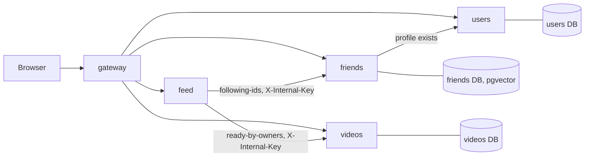

# Lesson 2. Friends, recommended friends on pgvector, the feed service

> Tag: `lesson-02` · Time: ~3–4 h · Builds on [lesson 1](01-upload-transcode-watch.md); the git tag `lesson-01` is the state before everything described here.

## Goal
Split the social graph out of the services of lesson 1. Follows move from `users` into a new **`friends`** service with its own database on PostgreSQL + **pgvector**; recommended friends are computed from graph embeddings; the feed leaves `videos` and becomes a stateless **`feed`** service that returns video ids, while `videos` serves cards by ids. As a bonus the graph gets follower/following lists and a "mutual" relation.


## Result
```bash
make up && make demo
# ...
# ▸ Follow → clip appears in the friend's feed, stream and description are visible
#   ✓ stats (friends service): isFollowing, followers ≥ 1
# ▸ Recommended friends: friends of friends (pgvector similarity)
# ▸ Unfollow → clip disappears from the feed
# Demo passed.
```
In the browser: "Search" → follow `demo-friend` → "Feed" shows the friend's clips (ids first, cards second) → the profile shows counters, followers/following lists (`/u/:id/followers`, `/u/:id/following`) and the badges "Mutual" / "Follows you".

## What changes compared to lesson 1
| Area | Lesson 1 (`lesson-01`) | Lesson 2 |
| --- | --- | --- |
| Follows | table `follows` in `users` (`PUT/DELETE /api/users/{id}/follow`, counters in profiles) | service `friends`, DB `friends` (pgvector); `users` is profiles only (migration `0003_drop_follows`) |
| Feed | `GET /api/feed` inside `videos`, which called `users` for following ids | service `feed` (no DB): `GET /api/feed` → `{ids,nextCursor}`; cards via `GET /api/videos/cards` in `videos` |
| Recommendations | — | `GET /api/friends/recommendations` (friends of friends by embedding similarity) |
| Postgres image | `postgres:18.x-alpine` | pinned `pgvector/pgvector` build |
| Containers | + `friends`, `friends-migrator`, `feed` | total without Ollama ≈ 11 CPU / 5.8 GB |

Decision record: [ADR 0010](../adr/0010-friends-and-feed-services.md). Contracts: [api.yaml](../../contracts/openapi/api.yaml), [internal-friends.yaml](../../contracts/openapi/internal-friends.yaml), [internal-users.yaml](../../contracts/openapi/internal-users.yaml), [internal-videos.yaml](../../contracts/openapi/internal-videos.yaml).



## Step-by-step walkthrough

### Step 1. Take follows out of `users`
`users` keeps only profiles: `GET /api/users/me`, `GET /api/users/{id}` (login, name, bio — no counters), `GET /api/users?query=` (prefix search) and the new batch lookup `GET /api/users?ids=a,b` used to render feed authors and recommendations ([Profiles.cs](../../services/users/Maksov.VideoService.Users.Features.Profiles/Profiles.cs)). It also exposes the internal `GET /internal/v1/users/{id}/exists`. The old table is removed by migration [0003_drop_follows](../../services/users/Maksov.VideoService.Users.Dal/Postgres/Migrations/0003_drop_follows.sql) (the follow table itself came from [0002_follows](../../services/users/Maksov.VideoService.Users.Dal/Postgres/Migrations/0002_follows.sql) in lesson 1).

### Step 2. The pgvector image and the extension init
The `friends` database stores vectors, so the shared PostgreSQL becomes the pinned `pgvector/pgvector` image ([docker-compose.yml](../../deploy/compose/docker-compose.yml)). A service role cannot create extensions, therefore the init script [00-databases.sh](../../deploy/postgres/init/00-databases.sh) creates the `friends` role and database and runs `create extension if not exists vector` there as the superuser. Init scripts run only on a fresh volume (`make down && make up` recreates it). New variable `FRIENDS_DB_PASSWORD` is generated into `.env` locally.

### Step 3. The `friends` service: follows
[Friends.cs](../../services/friends/Maksov.VideoService.Friends.Features.Friends/Friends.cs) owns `PUT/DELETE /api/users/{id}/follow` (idempotent, not yourself). Before creating a follow it asks `users` whether the profile exists ([UsersProfileDirectory.cs](../../services/friends/Maksov.VideoService.Friends.Dal/Http/UsersProfileDirectory.cs); positive answers are cached for 5 minutes; if `users` is down the answer is 503 and nothing is written). The migration [0001_init.sql](../../services/friends/Maksov.VideoService.Friends.Dal/Postgres/Migrations/0001_init.sql) creates `follows` and `user_embeddings`. The internal `GET /internal/v1/friends/{userId}/following-ids` ([contract](../../contracts/openapi/internal-friends.yaml)) feeds the feed service.

### Step 4. Recommended friends: `graph-hash-v1` embeddings
`GET /api/friends/recommendations` returns friends of your friends that you do not follow yet, ranked by the cosine similarity of **graph embeddings** and then by mutual friends. The baseline embedding ([GraphEmbedding.cs](../../services/friends/Maksov.VideoService.Friends.Bll/GraphEmbedding.cs)) is deterministic and needs no ML model: every user has a stable pseudo-random 32-dimensional vector `h(user)` derived from a hash, and the user's embedding is `normalize(h(user) + 0.5 · Σ h(followed))` — people who follow the same accounts get similar vectors. The embedding is recomputed for the follower on every follow/unfollow. Vectors live in a `vector(32)` column next to a `model_version`, with an HNSW index (`vector_cosine_ops`). The idea: the same table and query keep working when a real model replaces the baseline in lessons 10–11 — a new `model_version`, recomputed in the background, no downtime.

### Step 5. Mutual status and follower/following lists
`GET /api/friends/{id}/stats` returns counters plus the relation to the viewer: `isFollowing`, `followsYou`, `isMutual` (**mutual = both follow each other**). `GET /api/friends/status?ids=` answers for up to 50 users with `following` and `followedBy`. `GET /api/friends/{id}/followers` and `/following` return paged lists (newest first, keyset cursor, limit ≤ 50, default 20) with `total` and the same flags relative to the viewer. The web app renders them on [FollowListPage](../../clients/web/src/features/profile/FollowListPage.tsx) (`/u/:id/followers`, `/u/:id/following`) with "Mutual" / "Follows you" badges.

### Step 6. The `feed` service and the cards endpoint
The stateless [feed](../../services/feed/Maksov.VideoService.Feed.Features.Feed/Feed.cs) service takes your follows from `friends` (cached for 20 s — [FriendsFollowingSource.cs](../../services/feed/Maksov.VideoService.Feed.Dal/Http/FriendsFollowingSource.cs)), adds you, asks `videos` for the newest ready videos of those owners (internal `POST /internal/v1/videos/ready-by-owners`, [VideosCatalog.cs](../../services/feed/Maksov.VideoService.Feed.Dal/Http/VideosCatalog.cs), [contract](../../contracts/openapi/internal-videos.yaml)) and returns **a page of ids** with a cursor. If `friends` is down the feed degrades to your own videos; if `videos` is down — 503. The client then makes one more call, `GET /api/videos/cards?ids=` ([Catalog.cs](../../services/videos/Maksov.VideoService.Videos.Features.Catalog/Catalog.cs)), which returns the cards of ready videos in the requested order (up to 30 ids). `Features.Catalog` also serves the profile grid `GET /api/users/{id}/videos`. `videos` no longer has a feed endpoint and no longer depends on `users`. The web [FeedPage](../../clients/web/src/features/feed/FeedPage.tsx) does the two calls.

### Step 7. Gateway and compose
New gateway routes in [appsettings.json](../../services/gateway/Maksov.VideoService.Gateway/appsettings.json): `GET /api/feed` → `feed`, `PUT|DELETE /api/users/{id}/follow` and `/api/friends/**` → `friends` (the follow route has `Order` 0, so it wins over the generic `/api/users/**`). In compose: `friends-migrator`, `friends` (0.5 CPU / 192M), `feed` (0.5 CPU / 160M, no database, no migrator); neither publishes a port; the gateway waits for both. Internal calls use the same `X-Internal-Key`.

## Verification
```bash
make up
make demo          # now includes: stats from friends, feed ids → cards, recommendations, unfollow
make test          # friends tests need the pgvector image — make test-dotnet starts the same pinned build
```
Tests: `services/friends/tests` (`AC_friends_01..10`, `FriendsAdapterTests` on a real PostgreSQL with pgvector, `GraphEmbeddingTests`), `services/feed/tests` (`AC_feed_01..05`), `services/videos/tests` (`AC_feed_01..03` for cards, grid and ready-by-owners), `services/users/tests` (`AC_users_07..11`). Acceptance criteria — [stories](../stories/lesson-02-friends-feed.md).

## Common mistakes
| Symptom | Cause | Fix |
| --- | --- | --- |
| `type "vector" does not exist` in the `friends` migration | the shared Postgres is not the pgvector image, or the volume was created before the extension was added | use the pinned `pgvector/pgvector` image; `make down && make up` to recreate the volume |
| `permission denied to create extension "vector"` | the migration tries to create the extension with the service role | create the extension in the init script as the superuser, not in migrations |
| Following returns 503 | `friends` cannot confirm the profile with `users` (or `INTERNAL_API_KEY` does not match) | `make logs s=friends`, check `users` health |
| The feed is empty after following | the follow list is cached in `feed` for 20 s; only `ready` videos appear | wait, [runbook](../slo/lesson-02.md) |
| Feed ids arrive but a card is missing | `GET /api/videos/cards` returns ready videos only (deleted or not ready ids are skipped) | skip missing cards; do not retry |
| `docker compose`: "required variable FRIENDS_DB_PASSWORD is missing" | `.env` predates the variable | `make env-sync` (called by `make up`) |
| Recommendations are empty | the viewer follows nobody, or all friends of friends are already followed | check `follows` and `user_embeddings` (`model_version = graph-hash-v1`) |

## Self-check exercises
1. Why was the feed moved out of `videos`? Which dependency disappeared, and what does it unlock for fan-out (lesson 7) and ranking (lesson 11)?
2. A feed page costs the client two calls. What is the benefit of returning ids only, and when would you merge the calls?
3. Stop `friends` and open the feed: why is the response 200 and not 5xx? How long until follows return after `friends` starts, and why? What happens if `videos` is stopped instead?
4. Open `user_embeddings`: why are vectors stored with `model_version`, and how would you roll out a better model without downtime?
5. Two users follow the same ten accounts. What does `graph-hash-v1` say about their similarity, and why?
6. Why is `create extension vector` in the init script and not in a migration?
7. ★ Make `isMutual` available in the feed cards. Which service should own the data, and what would the extra call cost?

## What's next
Next: [lesson 3](03-likes-events-graphql.md) adds likes, domain events and GraphQL; lesson 4 builds the data lake ingestion; lesson 6 replaces the outbox transport with Kafka; lesson 7 moves the feed to hot storage with fan-out; lessons 10–11 replace the `graph-hash-v1` baseline with real embeddings and ranking.
