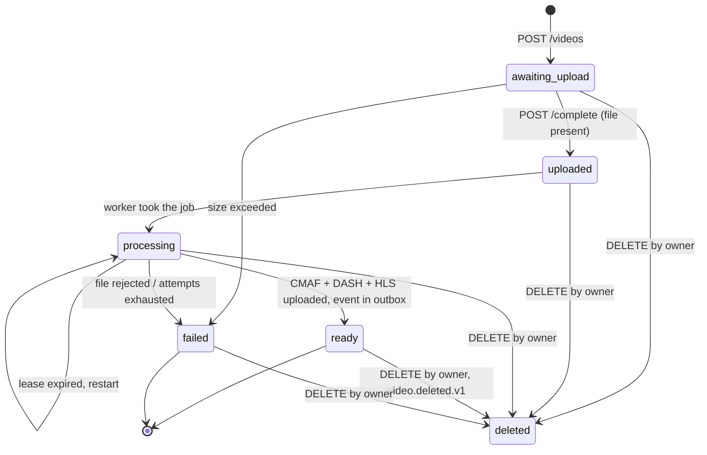

# Lesson 1: upload, transcoding, playback, profiles, feed, comments

> State at the git tag `lesson-01` (follows in `users`, feed in `videos`); test names refer to that tag. Later changes — [lesson 2](lesson-02-friends-feed.md).

- **ADR:** [0001](../adr/0001-lesson-01-upload-transcode-watch.md), [0002](../adr/0002-cmaf-dash-and-hls.md), [0003](../adr/0003-keycloak-identity.md), [0006](../adr/0006-microservices-gateway-videos-users-analysis.md), [0007](../adr/0007-vertical-first.md), [0008](../adr/0008-separate-solutions-nuget.md), [0009](../adr/0009-social-features-comments.md)
- **Contracts:** [contracts/openapi/api.yaml](../../contracts/openapi/api.yaml), [internal-analysis.yaml](../../contracts/openapi/internal-analysis.yaml), [internal-comments.yaml](../../contracts/openapi/internal-comments.yaml), [internal-users.yaml](../../contracts/openapi/internal-users.yaml), [video-processed.v1.json](../../contracts/events/video-processed.v1.json), [video-deleted.v1.json](../../contracts/events/video-deleted.v1.json)

## Stories

**US-1.** As a user, I want to sign in (login/password or Google/Microsoft) so that my videos are only mine.
**US-2.** As a user, I want to upload a video file and see progress so that I know how long to wait.
**US-3.** As a user, I want the video to be prepared automatically for playback in multiple qualities so that it plays on a slow network too.
**US-4.** As a user, I want to see a list of my videos with their statuses and watch the ready ones.
**US-5.** As a user, I want an automatic description of my video (text and tags) so that I don't have to write it by hand.
**US-6.** As a user, I want a profile with a name and bio so that people recognize me.
**US-7.** As the service owner, I want a single entry point with token validation and rate limiting so that internal services are not directly reachable from outside.
**US-8.** As a phone user, I want vertical videos without SAR metadata to be processed as reliably as any others.
**US-9.** As a user, I want to find people, follow them and see their ready videos and my own in the feed so that I can watch interesting content.
**US-10.** As a user, I want to open a person's profile — name, bio, counters, a grid of their videos — and watch their ready videos.
**US-11.** As a viewer, I want to comment on a video; as an author, to delete my own comments and any comments under my video.
**US-12.** As an author, I want to delete my video so that it disappears from the feed and profile, together with its files, description and comments.

_Deferred: "Interesting videos" (recommendations) — lessons 8–9._

| ID | Given | When | Then |
| --- | --- | --- | --- |
| AC-auth-03 | demo user with a phone | sign in by login, e-mail, phone (incl. "8 000 000 00 01") | token with `aud=videoservice-api` |
| AC-auth-04 | new visitor | register with a phone and no e-mail, then sign in by login and phone | account created, both sign-ins work |
| AC-auth-05 | phone already taken / not E.164 | registration | rejected with a clear message |
| AC-auth-06 | web opened at `127.0.0.1` or `localhost` | sign-in | redirect_uri accepted; a foreign one rejected |
| AC-upload-01 | signed-in user | POST /api/videos with valid title, contentType, sizeBytes | 201, presigned PUT to MinIO with Content-Type, video `awaiting_upload` |
| AC-upload-02 | signed-in user | unsupported type, empty or too large file | 400 Problem Details with the field |
| AC-upload-03 | video `awaiting_upload`, no file in storage | POST /complete | 409 `upload_missing` |
| AC-upload-04 | file uploaded | POST /complete twice | 202 both times, status `uploaded`, exactly one job |
| AC-transcode-01 | job in the queue | worker processes it | status `ready`, `manifest.mpd`, `master.m3u8`, segments and poster exist; ladder without upscaling |
| AC-transcode-02 | vertical / rotated / silent video | processing | correct orientation; without audio — video track only |
| AC-transcode-03 | corrupt file / not a video / > 10 min / > 4K | processing | `failed` with `failureReason`, no retry |
| AC-transcode-04 | worker crashed mid-job | lease expired | another worker takes the job, a single result |
| AC-transcode-05 | vertical 720×1280 video **without SAR** (as from a phone) | processing | `setsar=1` added before `split`, DASH builds without "Conflicting stream aspect ratios", `ready`, rungs by short side |
| AC-describe-01 | video became `ready` | an event is written to `outbox` | exactly one `video.processed.v1` event with the contract fields in the same transaction; no event for `failed` |
| AC-describe-02 | event delivered to analysis | worker analyzes the video | `GET /api/videos/{id}/description` → `queued`/`processing`, then `done` with Russian-language text and tags |
| AC-describe-03 | description not ready or analysis failed | GET description | `text = null`; an analysis failure does not change the video status |
| AC-describe-04 | nonexistent or deleted video; someone else's video whose analysis is not `done` | GET description | 404; the owner sees any status, others only `done` |
| AC-describe-05 | vertical video with three shots, sound and a pause | analysis | the description has shot changes, orientation, sound and silence; no invented facts, no data — item omitted |
| AC-users-01 | no token | `/api/users/*` | 401 |
| AC-users-02 | new user | GET /api/users/me | profile created, `displayName` = login; repeated and parallel first requests do not duplicate the profile |
| AC-users-03 | signed-in user | PUT /api/users/me {displayName 1..60, bio ≤ 300} | values trimmed at the edges and saved |
| AC-users-04 | empty name or too long fields | PUT /api/users/me | 400 Problem Details |
| AC-users-05 | any signed-in user | GET /api/users/{id} | public profile: `username`, `displayName`, `bio`, `followersCount`, `followingCount`, `isFollowing`; unknown id — 404 |
| AC-users-06 | someone else's identifier in the request body | PUT /api/users/me | only own profile changes (the owner is taken from `sub`) |
| AC-users-07 | user A | PUT /api/users/{B}/follow twice, then DELETE | 204 both times (idempotent); B's followers and A's following counters change by 1; `isFollowing` reflects the state |
| AC-users-08 | user A | follow self / a nonexistent user | 400 / 404 (self-follow is also forbidden by the DB) |
| AC-users-09 | there are people in the DB | GET /api/users?query=<login or name prefix> | case-insensitive prefix matches, excluding self, `isFollowing` set; empty query — empty list |
| AC-users-10 | request without a key or with a wrong one | GET /internal/v1/users/{id}/following-ids | 401 |
| AC-gateway-01 | request without a token | any `/api/*` | 401 at the gateway, services are not called |
| AC-gateway-02 | valid token | `/api/videos/**`, `/api/feed`, `/api/users/**`, `GET /api/users/{id}/videos`, `GET /api/videos/{id}/description`, `/api/videos/{id}/comments/**` | request goes to videos / videos / users / videos / analysis / comments respectively |
| AC-gateway-03 | any token | `/internal/**` through the gateway | 404 |
| AC-gateway-04 | without a token | `/` and health | available |
| AC-gateway-05 | more than 20 upload creations per minute | POST /api/videos | 429 for this user, others unaffected |
| AC-analysis-01 | request without a key or with a wrong one | POST /internal/v1/events/video-processed | 401 |
| AC-analysis-02 | valid event | send twice | 202 both times, a single analysis job |
| AC-analysis-03 | `schemaVersion` ≠ 1, empty ids, foreign `sourceKey`, non-positive sizes | POST event | 400 |
| AC-analysis-04 | request without a token | GET /api/videos/{id}/description | 401 |
| AC-analysis-05 | analysis in progress or finished | owner and another user request the description | owner sees `queued`/`processing`/`done`, the other only `done` |
| AC-analysis-06 | analysis failed | GET description by the owner | `status = failed`, `text = null` |
| AC-analysis-07 | description not ready | GET description by a non-owner | 404 |
| AC-analysis-08 | `video.deleted.v1` event | POST /internal/v1/events/video-deleted (incl. repeat) | analysis and description deleted; 202 both times; without a key — 401 |
| AC-comments-01 | request without a token | `/api/videos/{id}/comments` | 401 |
| AC-comments-02 | video unknown to the comments service | GET / POST comments | 404 |
| AC-comments-03 | empty text | POST comment | 400 |
| AC-comments-04 | text longer than 500 characters | POST comment | 400 |
| AC-comments-05 | several comments | GET comments | newest first, `total`, cursor pagination, `canDelete` on own |
| AC-comments-06 | comment by another author | DELETE by the author / video owner / an outsider | author and video owner — 204; outsider — 404 |
| AC-comments-07 | request without a key or with a wrong one | POST /internal/v1/events/video-processed and video-deleted | 401 |
| AC-comments-08 | `video.processed.v1` and `video.deleted.v1` events | delivery, incl. repeat | video is registered and forgotten idempotently; comments of the deleted video are removed |
| AC-comments-09 | wrong schema version / empty identifiers | POST event | 400 |
| AC-feed-01 | A follows B; A, B, C have ready and non-ready videos | GET /api/feed as A | ready videos of B and A, newest first; not C's and not non-ready ones; cursor pagination; if users is unavailable — own only |
| AC-feed-02 | a person has ready videos | GET /api/users/{id}/videos | grid of their ready videos, newest first |
| AC-delete-01 | a video, its owner and an outsider | DELETE /api/videos/{id} | outsider — 404; owner — 204, the video disappears (404 for all), files removed from MinIO, one outbox row each for analysis and comments |
| AC-library-01 | user has N videos, another has M | GET /api/videos | only own, newest first, cursor pagination |
| AC-watch-01 | video `ready` | GET /api/videos/{id} | `playback.dash`, `playback.hls`, `renditions`; manifest is served |
| AC-watch-02 | video not `ready` (for a non-owner), deleted | GET /stream/... | 404; a ready video is open to any authenticated user |
| AC-watch-03 | video `ready` | open in the web client | DASH and HLS play; manual quality switching and Auto |
| AC-auth-01 | someone else's video | complete, delete; GET while it is not `ready` | 404 |
| AC-auth-02 | without a token | any /api | 401 |
| AC-security-01 | `file` with `..`, `/`, unknown extension | GET /stream/{file} | 404 |

## NFR
- API (without files): p95 < 300 ms locally.
- Time to Ready: p95 < 3× video duration on 2 CPU.
- Reliability: a job is not lost when a worker crashes (lease), retry is idempotent.
- Feed: p95 `GET /api/feed` < 300 ms with the follow cache (20 s); if users is unavailable — degradation to own videos, not an error.
- Resources: videos ≤ 256 MB, comments ≤ 192 MB, media-worker ≤ 1.5 GB / 2 CPU, analysis ≤ 256 MB, analysis-worker ≤ 768 MB / 1 CPU, gateway ≤ 192 MB.
- Description: p95 time for the description to appear < 30 s after `ready` for a video ≤ 1 min on a local machine.
- Event delivery: not lost when analysis is unavailable (outbox, retries with backoff 5 s … 5 min).

## Video lifecycle

## Traceability
| AC | Test | Status |
| --- | --- | --- |
| AC-upload-01 | `VideoEndpointsTests.AC_upload_01_*`, `scripts/demo.sh` | green |
| AC-upload-02 | `VideoEndpointsTests.AC_upload_02_*`, `UploadPolicyTests` | green |
| AC-upload-03 | `VideoEndpointsTests.AC_upload_03_*` | green |
| AC-upload-04 | `VideoEndpointsTests.AC_upload_04_*`, demo | green |
| AC-transcode-01 | `FfmpegIntegrationTests.Produces_playable_dash_and_hls`, `RenditionLadderTests`, demo | green |
| AC-transcode-02 | `FfmpegIntegrationTests`, `RenditionLadderTests.Portrait_video_is_scaled_by_short_side`, `FfprobeParserTests` | green |
| AC-transcode-03 | `FfmpegIntegrationTests.Truncated_*`, `Text_file_*`, `MediaPolicyTests` | green |
| AC-transcode-04 | `PostgresAdaptersTests.Expired_lease_is_reclaimed_and_stale_worker_cannot_finish`; manual chaos scenario (`docs/slo/lesson-01.md`); automated chaos test — lesson 12 | green / manual |
| AC-transcode-05 | `FfmpegArgsBuilderTests.Source_without_sar_gets_square_pixels_before_split`, `Source_with_sar_keeps_it`, `FfprobeParserTests.Detects_whether_source_has_sar`, `FfmpegIntegrationTests`, demo (720×1280 video without SAR) | green |
| AC-describe-01 | `OutboxTests.Completing_a_video_writes_one_event_per_subscriber_with_contract_fields`, `Failed_video_produces_no_event`, `Claim_locks_messages_and_failure_applies_backoff_until_sent` | green |
| AC-describe-02 | `DescriptionsApiTests.AC_analysis_05_*`, `AnalysisAdapterTests.Enqueue_is_idempotent_and_full_cycle_produces_description` (`services/analysis/tests`), demo | green |
| AC-describe-03 | `DescriptionsApiTests.AC_analysis_06_failed_analysis_has_no_text` | green |
| AC-describe-04 | `DescriptionsApiTests.AC_analysis_05_*`, `AC_analysis_07_*`, demo | green |
| AC-describe-05 | `FfmpegInspectorTests`, `DescriptionComposerTests`, `StatsParsersTests`, `OllamaClientTests` (optional frame captioning) | green |
| AC-users-01..10 | `UsersApiTests.AC_users_01_*` … `AC_users_10_*` (`services/users/tests`); `UsersAdapterTests` (Follow, Self_follow, Search); demo (follow, unfollow) | green |
| AC-gateway-01..05 | `GatewayTests.AC_gateway_01_*` … `AC_gateway_05_*`; demo (401 without a token, 404 on `/internal`) | green |
| AC-analysis-01 | `DescriptionsApiTests.AC_analysis_01_*` | green |
| AC-analysis-02 | `DescriptionsApiTests.AC_analysis_02_*`, `AnalysisAdapterTests` | green |
| AC-analysis-03 | `DescriptionsApiTests.AC_analysis_03_*` | green |
| AC-analysis-04 | `DescriptionsApiTests.AC_analysis_04_*` | green |
| AC-analysis-05 | `DescriptionsApiTests.AC_analysis_05_owner_sees_progress_others_see_only_done` | green |
| AC-analysis-06 | `DescriptionsApiTests.AC_analysis_06_failed_analysis_has_no_text` | green |
| AC-analysis-07 | `DescriptionsApiTests.AC_analysis_07_unfinished_description_is_hidden_from_others` | green |
| AC-analysis-08 | `DescriptionsApiTests.AC_analysis_08_video_deleted_removes_analysis_and_is_idempotent`, demo (no description after deletion) | green |
| AC-comments-01..09 | `CommentsApiTests.AC_comments_01_*` … `AC_comments_09_*`; `CommentsAdapterTests` (video registration, pagination, "tombstone", deleting a single comment) (`services/comments/tests`); demo | green |
| AC-feed-01 | `VideoEndpointsTests.AC_feed_01_shows_ready_videos_of_followed_authors_and_own`, demo (feed before and after follow/unfollow) | green |
| AC-feed-02 | demo (author's profile grid); the query is shared with the feed slice (`ListReadyByOwnersAsync`) | demo |
| AC-delete-01 | `VideoEndpointsTests.AC_delete_01_only_owner_can_delete_and_media_is_removed`, `OutboxTests.Deleting_a_video_writes_deleted_event_per_subscriber_and_blocks_completion`, demo | green |
| AC-library-01 | `VideoEndpointsTests.AC_library_01_*`, `PostgresAdaptersTests.Keyset_paging_*`, demo | green |
| AC-watch-01 | `VideoEndpointsTests.AC_watch_01_*`, demo | green |
| AC-watch-02 | `VideoEndpointsTests.AC_watch_02_stream_is_denied_before_ready_but_open_to_other_users_when_ready` | green |
| AC-watch-03 | manual browser check (Chrome, Safari) | manual |
| AC-auth-01 | `VideoEndpointsTests.AC_auth_01_*` | green |
| AC-auth-02 | `VideoEndpointsTests.AC_auth_02_*`, `GatewayTests.AC_gateway_01_*`, demo | green |
| AC-auth-03..06 | `make verify-auth` (`scripts/verify-auth.py`) | green |
| AC-security-01 | `VideoEndpointsTests.AC_security_01_*`, `MediaKeysTests`, demo | green |
